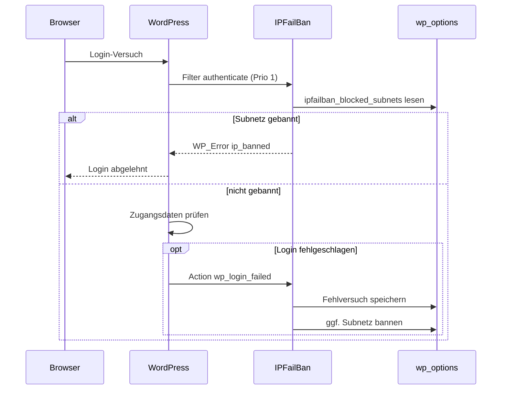
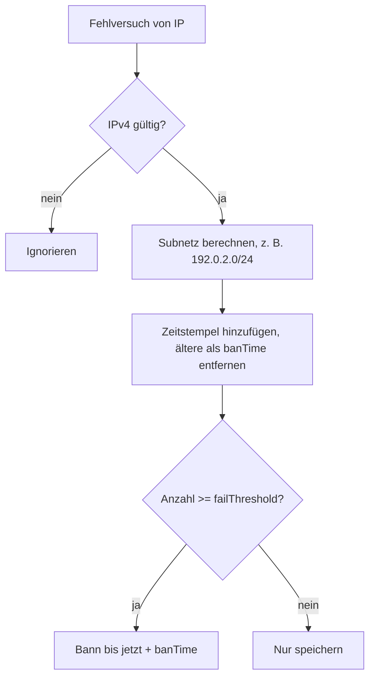

# Architektur

[← Zurück zur README](../README.md)

## Überblick

Das Plugin besteht aus einer einzigen Datei, `ip-failban.php`. Sie enthält die Klasse `IPFailBan` (Logik und Speicherung) sowie die WordPress-Hooks, die diese Klasse an Login-Vorgang und Admin-Menü anbinden. Eine Instanz wird global als `$ipFailBan` erzeugt.

## Komponenten

| Komponente | Typ | Aufgabe |
|---|---|---|
| `IPFailBan` | Klasse | Subnetzberechnung, Zählen der Fehlversuche, Bann-Prüfung, Entbannen |
| `wp_login_failed` | Action | Registriert jeden fehlgeschlagenen Login für die Client-IP |
| `authenticate` (Priorität 1) | Filter | Bricht die Authentifizierung mit `WP_Error` ab, wenn das Subnetz gebannt ist |
| `admin_menu` | Action | Fügt die Seite „IP Fail Ban“ (`ip-failban-admin`) hinzu |
| Option `ipfailban_failed_attempts` | Datenspeicher | Zeitstempel der Fehlversuche je Subnetz |
| Option `ipfailban_blocked_subnets` | Datenspeicher | Subnetz => Unix-Zeitstempel des Bann-Endes |

## Datenfluss

## Bann-Logik

## Hinweise

- Nur IPv4 wird unterstützt; andere Adressen ergeben kein Subnetz und werden weder gezählt noch gesperrt.
- Abgelaufene Banns werden beim nächsten `is_blocked()`-Aufruf für das Subnetz entfernt; die Übersicht blendet abgelaufene Einträge aus.
- Die Client-IP stammt aus `$_SERVER['REMOTE_ADDR']`.